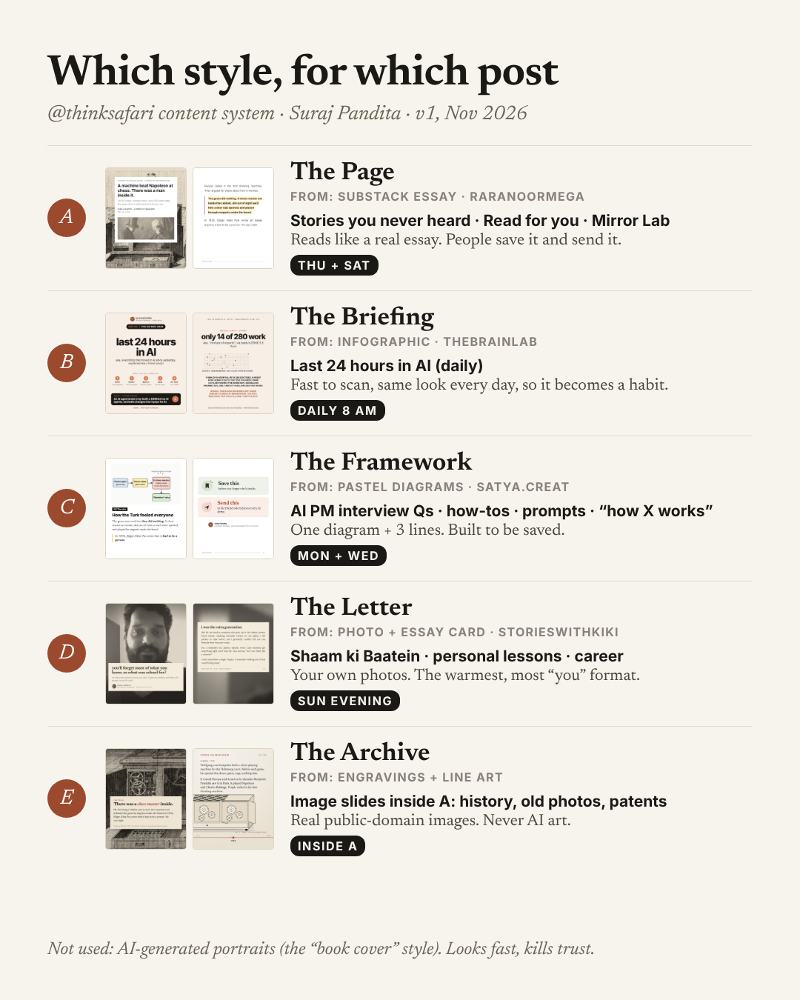
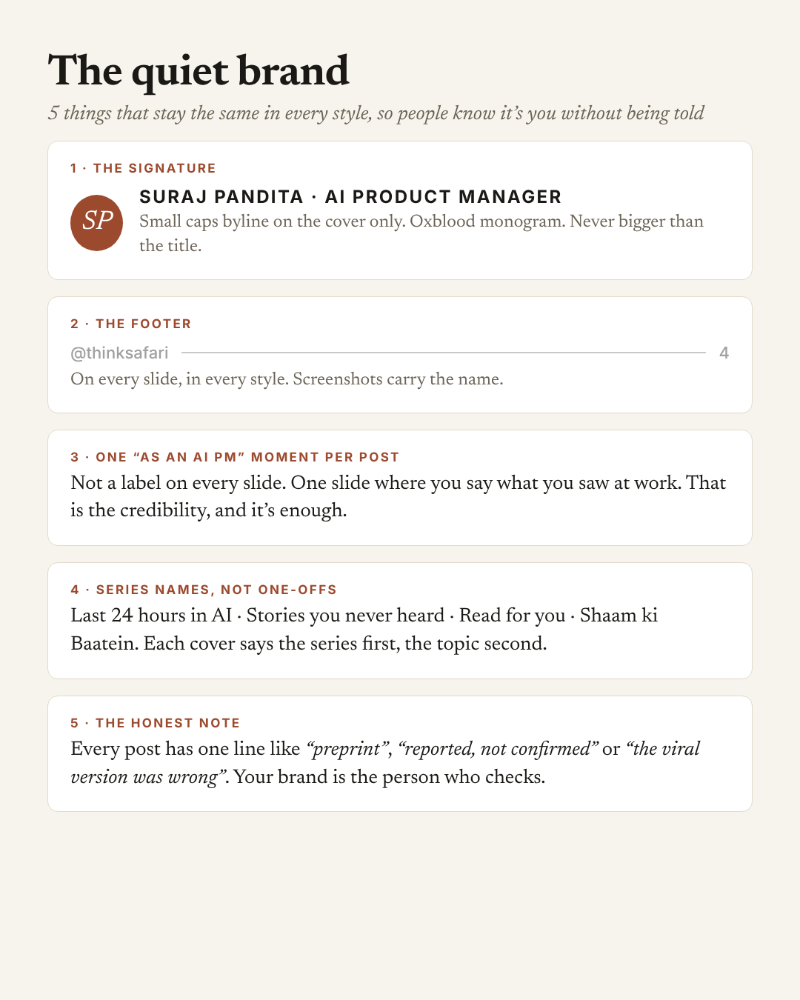

# @thinksafari content studio — read this first

Personal brand of **Suraj Pandita, AI Product Manager in India**. Instagram @thinksafari.
Niche: AI explained simply and honestly for people who build, with an AI PM's take and an India angle.
Talk to Suraj in Hinglish. Slide text and captions in English.

This folder is the shared memory for every Claude session making content. The same context also lives in
Google Drive, folder **"thinksafari Content Studio"** (id `1YZBQJv6aHESXvGleybQG5tfI0Czhq3dz`):
`Content Studio Context (read first) · v3`, `STYLE SYSTEM v1 · …`, reference docs, and every finished post.

## Style system (which style for which post)

| | Style | Reference it came from | Use for | When |
|---|---|---|---|---|
| A | **The Page** | raranoormega (Substack essay carousel) | Stories you never heard · Read for you · Mirror Lab | Thu + Sat |
| B | **The Briefing** | thebrainlab (infographic) | Last 24 hours in AI (daily) | Daily 8 AM IST |
| C | **The Framework** | satya.creat (pastel diagrams) | AI PM interview Qs · how-tos · prompts · "how X works" | Mon + Wed |
| D | **The Letter** | storieswithkiki (photo + essay card) | Shaam ki Baatein · personal lessons · career | Sun evening |
| E | **The Archive** | engravings, old photos | image slides inside A | — |

Not used: AI-generated portraits ("book cover" style). Looks fast, kills trust.
Reference screenshots: Drive folder `1_0xY0yeNuuGWdN_sY6P518qz_-HLwFDB`.

## The quiet brand (same in every style)

1. **Signature:** Suraj approved using his full name, **Suraj Pandita**, on all content (cover byline, end card, captions).
    `SURAJ PANDITA · AI PRODUCT MANAGER` small caps on the cover only + oxblood `SP` monogram (`#9C4A2E`). Never bigger than the title.
2. **Footer:** `@thinksafari ———— n` on every slide.
3. **One "as an AI PM" moment per post** — one slide with something real from his work. Not a label on every slide. Opinion slides are drafts: Suraj approves them.
4. **Series first, topic second** on every cover.
5. **One honest note per post** ("preprint", "reported, not confirmed", "the viral version was wrong"). Every number has a named source.

## When Suraj sends new reference carousels

He will keep sending the best carousels he finds (screenshots in Drive folder `1_0xY0yeNuuGWdN_sY6P518qz_-HLwFDB`, or in chat). For each batch:

1. Look at every screenshot. Note the creator, likes/shares/saves if visible, and what makes it work (hook, layout, type, colour, image source, swipe mechanic, CTA).
2. Check it against the quiet-brand rules and the "No AI slop" gate. Skip anything built on AI-generated people or fake photos, and say why.
3. Decide: does it improve an existing style (A–E), or is it a new style F? Name it, and say which topics it fits best and why.
4. Add a row to `style-system/references.md` (date, creator, what we took, which style, which topics).
5. If it's a new or changed style, update the table above and re-render the style board.
6. Tell Suraj in Hinglish, in a few lines: what's good, what we'll take, which topic it fits, and offer one post in that style.

## What's here

| Folder | What | Run |
|---|---|---|
| `last-24-hours-in-ai/` | Style B daily kit: `make.js`, fonts, JSON schema, Day 02 issue. See its README. | `node make.js issues/<date>.json` |
| `stories-you-never-heard/` | Style A template, Ep 01 "The Turk" (10 slides), its public-domain images and caption. | `node ep01-the-turk.js` |
| `style-system/` | The two style-board pages above. | — |

Fonts (Inter, Newsreader; SIL OFL) live in `last-24-hours-in-ai/fonts/` and are shared by all templates.
Rendered PNGs are not committed (`out/`, `issues/<date>/`); regenerate them. Needs Node + Playwright + Chromium.

## Automation and environments

- **Nightly scheduled task** "Last 24 hours in AI · nightly build": 00:07 IST, ready by 1 AM, Suraj schedules the post for 8 AM.
  It uploads each episode to a Drive folder `Last 24 hours in AI · Day NN · <date>` and backs up from `last-24-hours-in-ai-kit.zip` on Drive if this repo isn't present.
- **Images:** archive/museum sites are blocked in the Default cloud environment. Use the **"Reel studio - photos"** environment
  (Wikimedia Commons, Openverse, Flickr, Met, Art Institute of Chicago, Cleveland Museum, Substack, Drive). Only public-domain
  or Suraj's own photos, credited on the slide and in the caption. Wikimedia rate-limits: send a descriptive User-Agent and pause between requests.
- **Drive uploads:** upload captions as `text/plain` with conversion off; Google Docs conversion breaks emojis.

## Posts made (Nov 2026)

| Post | Style | Drive |
|---|---|---|
| Last 24 hours in AI · Day 02 (26 Nov) | B | folder `1p8c-RR4n9fORIj2J1zpl7mMOj6kp0zIM` |
| Read for you · Ep 01 · "You'll forget most of what you learn" | D | folder `1aLaQKNN4eY-if_-ajlH4FGZUm58EYZCm` |
| Stories you never heard · Ep 01 · The Turk (final = v4, **approved by Suraj**) | A | folder `1_zydzrKxcWml8g51AT-LUeLA9gWfOEgV` |

Next up suggested: first style C post (AI PM interview question).
